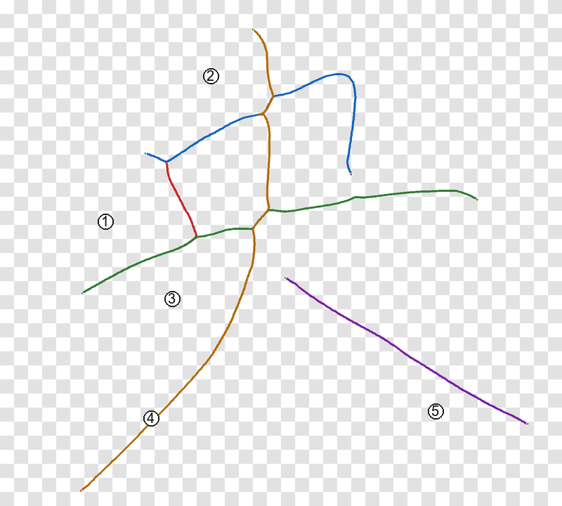

# 简单字迹生成 · simple-glyph

把一张书法/手写汉字图片，转成**按笔顺排列、可编辑、可动画的笔画中心线**。

[](https://github.com/Chhinfinite/simple-glyph/actions/workflows/ci.yml)
[](LICENSE)
[](https://www.python.org/)



> 输入是图片，输出不是“整字轮廓”，而是 **5 条开放的中心线**。  
> 每一条都可以单独改色、改粗细、做逐笔动画。

---

## 它做什么

- 从 PNG/JPEG 中提取黑色墨迹；
- 用人工 waypoint + 骨架图，把字拆成有顺序的笔画；
- 把每个笔画压成一条平滑、等距采样的中心线；
- 导出 SVG / JSON / PNG 预览；
- 生成一个零依赖的 SVG 逐笔书写动画；
- 保留“笔顺 + 几何”的可编辑性，方便二次设计。

## 它不做什么

- **不是 OCR**：字和笔顺需要你确认；
- **不是全自动拆字**：笔画 hint 仍需要人工给 3–6 个点；
- **不是字库生成器**：不保证和标准字帖完全一致；
- **不直接输出视频**：v0.1 输出 SVG 动画，MP4/WebP 在路线图里。

---

## 快速开始

```powershell
git clone https://github.com/Chhinfinite/simple-glyph.git
cd simple-glyph

python -m venv .venv
.\.venv\Scripts\Activate.ps1

pip install -e ".[dev]"
simple-glyph demo
```

`demo` 会用仓库自带的「央」示例，生成到 `examples/output/`：

```text
央_centerline.svg           # 主交付：5 条开放路径，fill=none
央_centerline_colored.svg   # 分色 + 编号
央_animation.svg            # 逐笔书写动画
央_centerline.json          # 点列、笔顺、画布
央_preview_checker.png      # 棋盘格预览
央_preview_white.png        # 白底预览
央_overlay.png              # 叠在原图上检查
```

也可以直接跑：

```powershell
simple-glyph trace `
  --image examples/input/央.png `
  --hints examples/hints/央.json `
  --out output `
  --character 央
```

---

## 安装

### 从源码（推荐开发）

```powershell
git clone https://github.com/Chhinfinite/simple-glyph.git
cd simple-glyph
python -m venv .venv
.\.venv\Scripts\Activate.ps1
pip install -e ".[dev]"
```

### 只装运行时

```powershell
pip install -e .
```

依赖：`numpy`、`Pillow`、`scipy`、`scikit-image`。  
Python 3.9+。

---

## 命令行

### `trace`

从图片 + hint JSON 生成笔画。

```powershell
simple-glyph trace --image path/to/char.png --hints path/to/char.json --out output --character 央
```

常用参数：

| 参数 | 默认 | 说明 |
|---|---|---|
| `--threshold` | `200` | 灰度小于该值视为墨迹 |
| `--method` | `medial_axis` | `medial_axis` 更居中；`skeletonize` 更贴边 |
| `--sigma` | `2.2` | 中心线高斯平滑 |
| `--spacing` | `2.5` | 重采样间距（像素） |
| `--no-animation` | 关 | 不生成 `_animation.svg` |

### `render`

从已有的 `_centerline.json` 重新导出，不重新描图。

```powershell
simple-glyph render --data examples/output/央_centerline.json --out output
```

### `demo`

跑仓库自带示例。

```powershell
simple-glyph demo --out examples/output
```

### `info`

```powershell
simple-glyph info
```

---

## Python API

```python
from simple_glyph import trace_glyph, save_glyph
from simple_glyph.svg import centerline_svg, write_svg

glyph = trace_glyph(
    "examples/input/央.png",
    "examples/hints/央.json",
    character="央",
    threshold=200,
)

save_glyph(glyph, "output/央_centerline.json")
write_svg(centerline_svg(glyph), "output/央_centerline.svg")
write_svg(centerline_svg(glyph, colored=True, labels=True), "output/央_colored.svg")
write_svg(centerline_svg(glyph, animate=True), "output/央_animation.svg")
```

`Glyph` 是一个很薄的数据结构：

```python
Glyph(
    character="央",
    canvas=(800, 720),
    strokes=[Stroke(id="1", label="竖", points=np.ndarray, color="#c62828")],
)
```

---

## Hint 文件格式

```json
{
  "character": "央",
  "strokes": [
    {
      "id": "1",
      "label": "竖",
      "color": "#c62828",
      "waypoints": [[205, 225], [225, 270], [245, 315], [258, 342]],
      "label_at": [150, 315]
    }
  ]
}
```

- `waypoints` 只需要落在目标笔画附近，不需要精确压在中线上；
- 程序会把每个点吸到最近的骨架像素，再沿骨架图找最短路径；
- `label_at` 只影响预览图编号的位置。

---

## 工作原理

```text
RGB 图片
  → 灰度阈值（ink mask）
  → medial_axis / skeletonize
  → waypoint 吸附到骨架
  → 8 邻域 BFS 连成笔画路径
  → 高斯平滑
  → 2.5px 等距重采样
  → SVG（开放路径，fill=none）
  → JSON + PNG 预览 + SVG 动画
```

更细的说明见 [docs/pipeline.md](docs/pipeline.md)。

### 为什么是“半自动”

单张书法图的笔画自动分解仍然是开放问题。交叉、粘连、飞白、枯笔都会让全自动算法把两笔并成一笔。  
这个项目选择**把不可靠的部分交给人**：人只给 3–6 个 waypoint，程序负责沿骨架走、平滑、重采样、导出。  
这比“全自动但不可控”更适合做设计、教学和动画。

---

## 质量与限制

### 已做到

- 5 笔的「央」示例：中心线全部在墨迹内；
- 输出 SVG 是 5 条开放路径，`fill="none"`，无 `Z`，无背景；
- JSON 中每条笔画的点列、顺序、长度一致；
- 动画是纯 CSS/SVG，不需要 JS 或外部资源。

### 已知限制

- 笔画 hint 需要人工准备；
- 共用角（例如「央」第 1 笔与第 2/3 笔）会有几像素的端点取舍；
- 没有做标准字帖的非刚性对齐（DTW/TPS 在 roadmap 中）；
- 没有笔宽/枯笔/压力建模；
- 透明背景依赖输入图的 alpha 或亮度阈值，不保证抠图干净。

---

## 项目结构

```text
简单字迹生成/
├── src/simple_glyph/
│   ├── cli.py          # 命令行
│   ├── image.py        # 读图 / 墨迹 mask
│   ├── hints.py        # hint JSON
│   ├── skeleton.py     # 骨架图 + BFS + 重采样
│   ├── trace.py        # 高层入口
│   ├── svg.py          # 中心线 SVG + CSS 动画
│   ├── preview.py      # PNG 预览
│   └── models.py       # Glyph / Stroke
├── examples/
│   ├── input/央.png
│   ├── hints/央.json
│   └── output/         # demo 生成
├── tests/
├── docs/
└── .github/
```

---

## 路线图

- [x] v0.1：单字、人工 hint、中心线 SVG、CSS 动画
- [ ] v0.2：折线 → Bézier 曲线拟合
- [ ] v0.3：标准 medians + 仿射/DTW/TPS 对齐
- [ ] v0.4：批量 2–3 字名字，统一画布
- [ ] v0.5：笔宽/压力/枯笔建模
- [ ] v0.6：WebP/MP4/GIF 导出

见 [docs/roadmap.md](docs/roadmap.md)。

---

## 开发

```powershell
pip install -e ".[dev]"
python -m pytest -q
ruff check src tests
```

提交前请读 [CONTRIBUTING.md](CONTRIBUTING.md)。  
安全问题请按 [SECURITY.md](SECURITY.md) 私下报告。

---

## 许可证

MIT。见 [LICENSE](LICENSE)。

## 致谢

- [Hanzi Writer](https://hanziwriter.org/) 的标准笔顺数据（路线图中的对齐模式会用到）；
- 所有把书法变成可编辑矢量的开源前辈。

---

如果这个项目帮你省了一点描字的时间，欢迎 star、提 issue，或者直接拿它做你自己的字迹动画。
